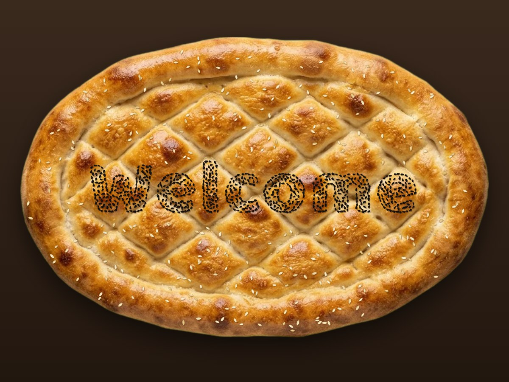
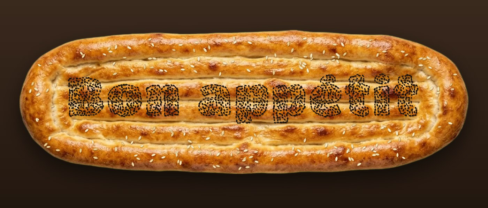
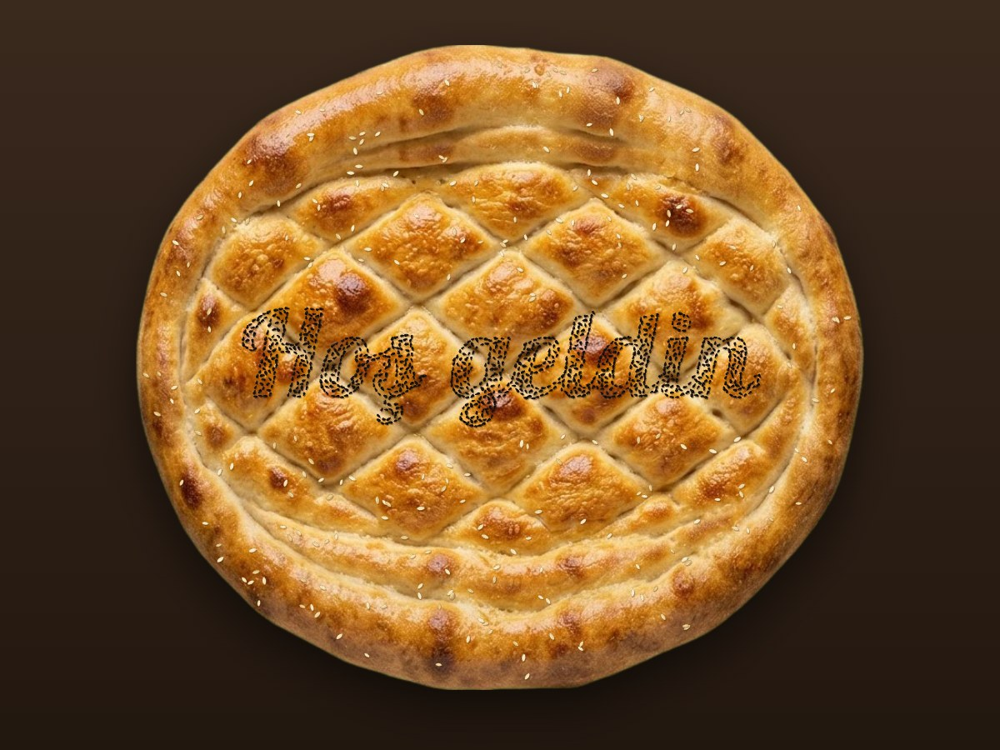
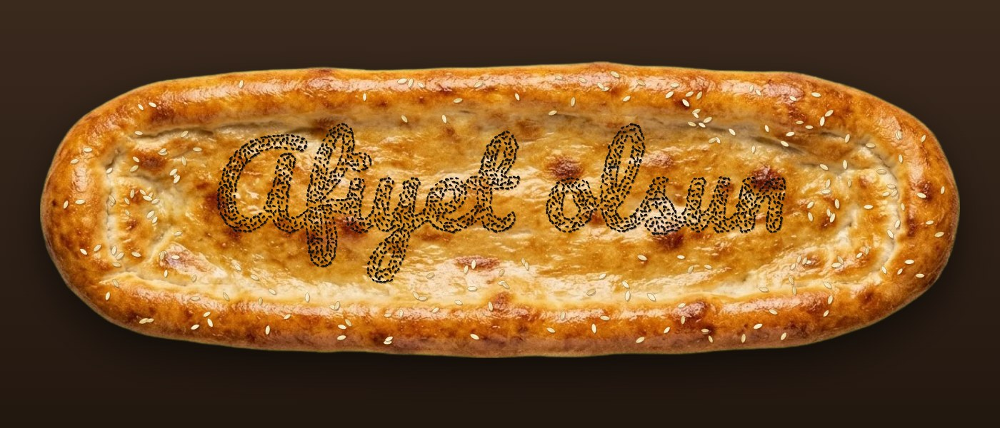

<p align="center">
  
</p>

<h1 align="center">Pide Mesaj · Pide Message</h1>

<p align="center">
  <b>Type something. We bake it onto a pide.</b><br>
  <i>Bir şey yaz, pidenin üstüne çörek otuyla serpelim.</i>
</p>

<p align="center">
  <a href="https://tahsingokalp.github.io/pide/">Try it · Dene</a> ·
  <a href="#english">English</a> ·
  <a href="#türkçe">Türkçe</a>
</p>

---

## English

Every Ramadan, Turkish bakeries pull thousands of glossy *ramazan pidesi* out of wood-fired ovens, sprinkled with black nigella seeds (*çörek otu*) and sesame. This little web app lets you skip the oven and write your own message on a pide, one seed at a time.

<p align="center">
  
</p>

### What it does

- **Writes with real-looking seeds.** Every letter is packed with hundreds of individually drawn nigella seeds. Seeds along the edges turn to follow the letter shape, so the writing stays readable.
- **Four real breads.** Oval and round Ramadan pide, a ridged *tırnak pide* and a long flat one, all photographed from above.
- **Five fonts**, from bold Baloo to curly Pacifico. Turkish letters (ç ğ ı ö ş ü) work fine.
- **Sprinkles itself.** Seeds fall onto the bread in writing order. Sesame is scattered around, never on top of your text.
- **Tweak it.** Seed density, seed size, text size, outline-only mode and a seed border.
- **Take it with you.** Download a PNG, or share. On phones the image itself is shared; the link remembers your text, font and bread.
- **Turkish and English**, picked from your browser language. Switch any time with the TR / EN button.

### How it works

No frameworks, no build step, no server: one HTML file, one CSS file and about 700 lines of plain JavaScript.

1. The bread photos were generated on a green screen and cut out to transparent WebP.
2. Your text is rendered into an invisible mask and fitted inside the flat middle of the bread using the real ink bounds of each font.
3. The mask is scanned for candidate points. Points near a letter edge are placed first and rotated along the edge, then the inside is filled using Poisson-disc spacing, so seeds touch but don't pile up.
4. Each seed is a small, slightly irregular shape with its own facet highlight and a soft shadow on the crust.

### Run locally

```bash
python3 -m http.server 8765
```

Then open `http://localhost:8765`.

---

## Türkçe

Her Ramazan fırınlardan binlerce parlak pide çıkar, üstünde çörek otu ve susamla. Bu küçük web uygulamasıyla fırına gerek kalmadan kendi yazını pidenin üstüne tane tane serpebilirsin.

<p align="center">
  
  
</p>

### Neler yapıyor

- **Gerçek gibi görünen tanelerle yazar.** Her harf, tek tek çizilmiş yüzlerce çörek otu tanesiyle dolar. Kenardaki taneler harfin çizgisine göre döner, böylece yazı net okunur.
- **Dört gerçek pide.** Oval ve yuvarlak Ramazan pidesi, tırnak pide ve uzun düz pide. Hepsi tepeden çekilmiş fotoğraf.
- **Beş yazı tipi**, kalın Baloo'dan kıvrımlı Pacifico'ya. Türkçe karakterler sorunsuz.
- **Kendiliğinden serpilir.** Taneler yazı sırasıyla pideye düşer. Susamlar etrafa serpilir, yazının üstüne düşmez.
- **Ayarlanabilir.** Tane sıklığı, tane boyutu, yazı boyutu, sadece kenar çizgisi ve çörek otu çerçeve.
- **İndir, paylaş.** PNG olarak indirebilir ya da paylaşabilirsin. Telefonda resmin kendisi paylaşılır. Bağlantı yazını, yazı tipini ve pideyi hatırlar.
- **Türkçe ve İngilizce.** Tarayıcı diline göre açılır, TR / EN düğmesiyle değiştirilir.

### Nasıl çalışıyor

Framework yok, derleme adımı yok, sunucu yok: bir HTML, bir CSS ve yaklaşık 700 satır düz JavaScript.

1. Pide fotoğrafları yeşil arka planda üretildi, arka planı silinip şeffaf WebP'ye çevrildi.
2. Yazı görünmez bir maskeye çizilir ve her yazı tipinin gerçek harf sınırları ölçülerek pidenin düz ortasına sığdırılır.
3. Maske taranır. Önce harf kenarlarına taneler dizilip kenar yönünde döndürülür, sonra içi Poisson-disk aralığıyla doldurulur. Taneler birbirine değer ama üst üste yığılmaz.
4. Her tane biraz düzensiz, parlak yüzlü ve kabuğa hafif gölge düşüren küçük bir şekildir.

### Yerelde çalıştırma

```bash
python3 -m http.server 8765
```

Sonra tarayıcıda `http://localhost:8765` aç.
